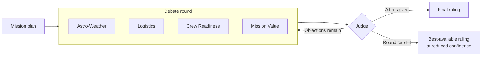
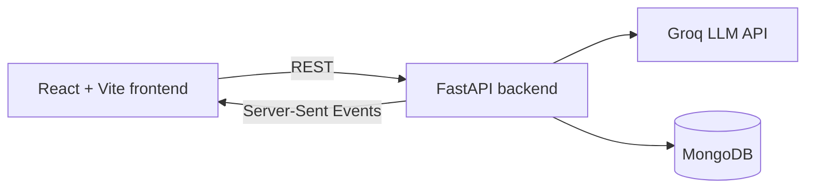

<div align="center">

# ÉTOCELEST

### A multi-agent space mission planner where AI agents debate the launch plan

Four domain agents argue. A Judge cross-examines. Nothing launches until every objection is resolved.

[**Live Demo**](https://etocelest.vercel.app) · [Run Locally](#-run-locally) · [Backend Docs](./etocelest-backend/README.md) · [Frontend Docs](./etocelest-frontend/README.md)


</div>

---

## About

Planning a space mission means balancing weather windows, supply chains, crew health, and mission payoff, and those concerns often pull in different directions.

ÉTOCELEST turns that tension into a structured debate. Each concern is owned by a specialist AI agent. The agents argue over a proposed launch plan in rounds, and a **Judge** sends them back to argue again until every objection is resolved. If a round cap is hit first, the Judge issues a **best-available ruling at reduced confidence**.

Nothing on screen is simulated. Missions, debates, rulings, and history all come from the backend API, and the live debate streams to the browser in real time.

## The Agents

| Agent | Responsibility |
|---|---|
| **Astro-Weather** | Launch windows, weather, and space-environment conditions |
| **Logistics** | Supplies, resources, and operational feasibility |
| **Crew Readiness** | Crew health, preparedness, and risk |
| **Mission Value** | Scientific and strategic payoff of the mission |
| **Judge** | Weighs every argument, sends the agents back until objections are resolved, and issues the final ruling |

## How It Works



1. A mission is submitted.
2. The four domain agents debate the launch plan in rounds.
3. The Judge reviews the round. If objections remain, the agents argue again.
4. The loop ends with a full-confidence ruling when everything is resolved, or a reduced-confidence ruling if the round cap is reached.

## Architecture



- The frontend talks to the backend over **REST** and receives the live debate over **Server-Sent Events**, with automatic reconnect and replay.
- The backend orchestrates the agents and the Judge, calls the Groq API, and persists missions, debates, and rulings in MongoDB.

## Tech Stack

| Layer | Technologies |
|---|---|
| **Frontend** | React, Vite, Tailwind CSS, PostCSS, Oxlint |
| **Backend** | Python 3.13, FastAPI, Uvicorn, Motor (async MongoDB), LangGraph |
| **AI** | Groq API |
| **Database** | MongoDB (Atlas, Docker, or local) |
| **Testing and tooling** | pytest, Docker, Docker Compose |

## Repository Structure

```
etocelest/
├── etocelest-backend/     # FastAPI service, agents, Judge loop, tests
│   ├── app/
│   ├── tests/
│   ├── Dockerfile
│   ├── docker-compose.yml
│   └── requirements.txt
├── etocelest-frontend/    # React + Vite app
│   ├── public/
│   ├── src/
│   └── package.json
├── RUN.md                 # Step-by-step run guide (Windows PowerShell)
└── README.md
```

## 🚀 Run Locally

### Prerequisites

- Python 3.13 (recommended)
- Node.js 20+
- A [Groq API key](https://console.groq.com/keys)
- MongoDB, using any one of:
  - [MongoDB Atlas](https://www.mongodb.com/atlas) free cluster (no install)
  - Docker: `docker run -d --name etocelest-mongo -p 27017:27017 mongo:7`
  - MongoDB Community Server (default URI `mongodb://localhost:27017`)

### 1. Backend

**macOS / Linux**
```bash
cd etocelest-backend
python3.13 -m venv .venv
source .venv/bin/activate
pip install -r requirements.txt
cp .env.example .env
```

**Windows (PowerShell)**
```powershell
cd etocelest-backend
py -3.13 -m venv .venv
.venv\Scripts\activate
python -m pip install -r requirements.txt
copy .env.example .env
```

Open `.env` and set:

```env
GROQ_API_KEY=your_groq_api_key
MONGODB_URI=your_mongodb_connection_string
```

Start the server:

```bash
uvicorn app.main:app_factory --factory --port 8000
```

Verify it is running at <http://localhost:8000/api/health>. You should see `"status":"ok"` and `"database":"ok"`.

### 2. Frontend

In a second terminal:

```bash
cd etocelest-frontend
npm install
cp .env.example .env        # Windows: copy .env.example .env
npm run dev
```

The `.env` file points the frontend at the backend:

```env
VITE_API_BASE_URL=http://localhost:8000
```

Open <http://localhost:5173>.

### Run tests (backend)

```bash
cd etocelest-backend
pip install -r requirements-dev.txt
pytest
```

## Documentation

| Doc | What's inside |
|---|---|
| [Backend README](./etocelest-backend/README.md) | API, agents, configuration |
| [Frontend README](./etocelest-frontend/README.md) | Pages, SSE client, configuration |
| [RUN.md](./RUN.md) | Quick run guide for Windows PowerShell |

## Acknowledgements

Powered by [Groq](https://groq.com), [FastAPI](https://fastapi.tiangolo.com), [LangGraph](https://www.langchain.com/langgraph), and [MongoDB](https://www.mongodb.com).